# NOTES

## Summary of changes
Six fixes (full explanations in [`handwritten/`](handwritten/handwritten1.jpg)):

1. **Archived tasks in search**: SQL `AND`/`OR` precedence; added parentheses.
2. **Slow search**: removed the artificial `Thread.sleep`.
3. **Race condition + stuck loading**: `AbortController` in `useTasks`; `setLoading(false)` in `.catch`.
4. **Null status crash**: null-safe `task.status` in `TaskTable`.
5. **`createdAt` null**: added `@CreationTimestamp`.
6. **Invalid status → 500**: now returns 400.

### Evidence
| Bug | Screenshots |
|---|---|
| 1 | 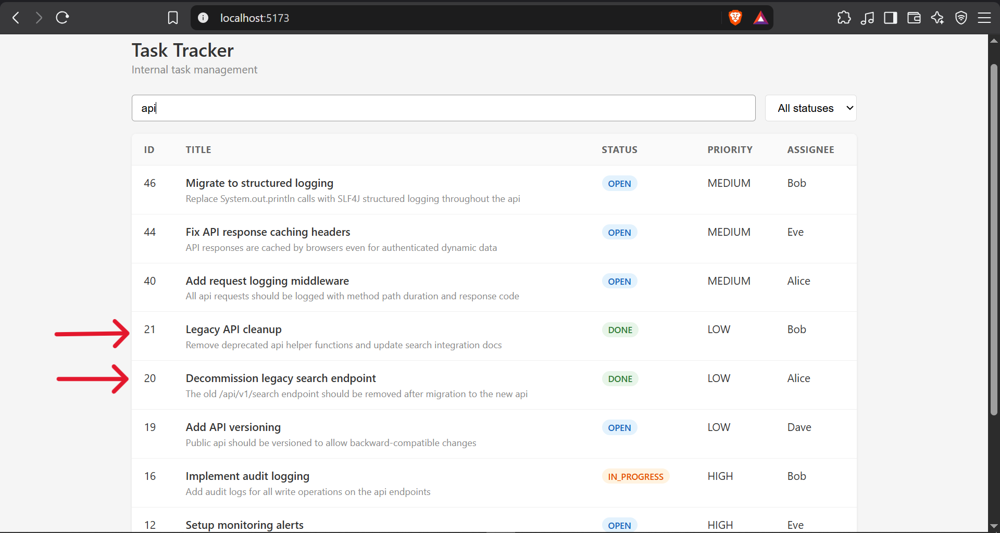 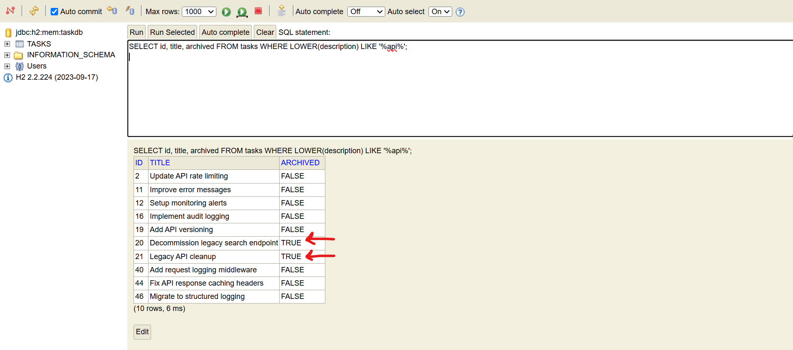 |
| 2, 3 | 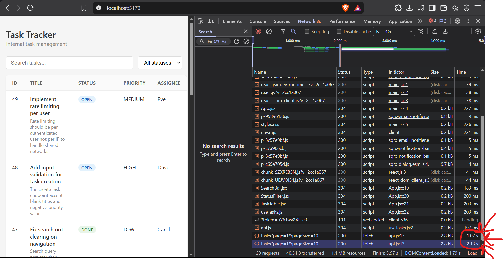 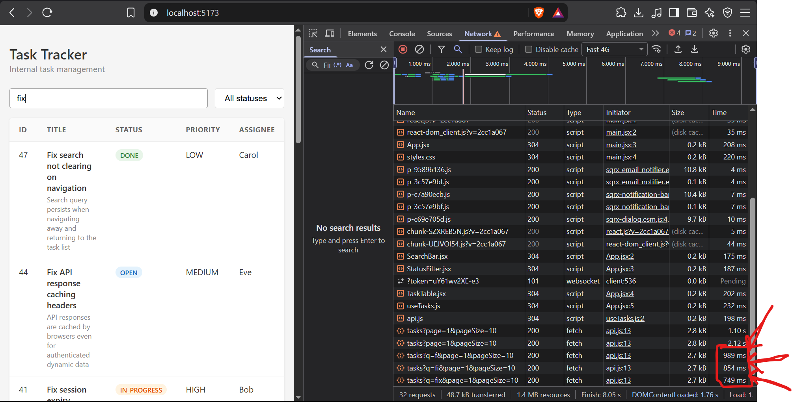 |
| 4 | 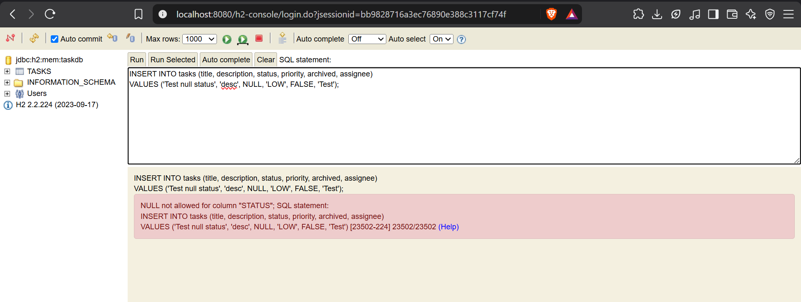 |
| 5 | 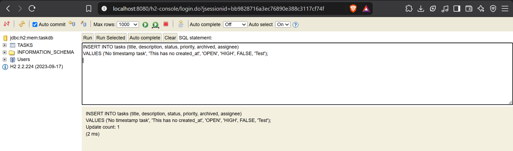 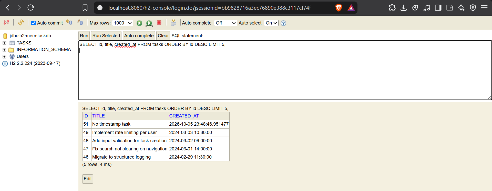 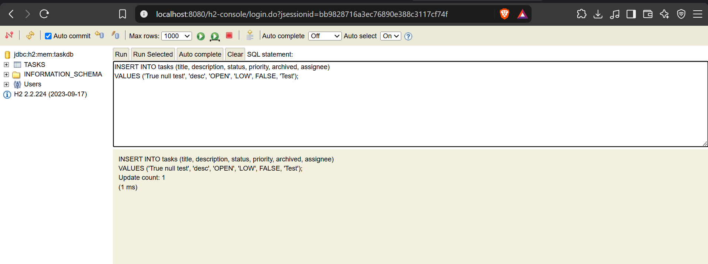 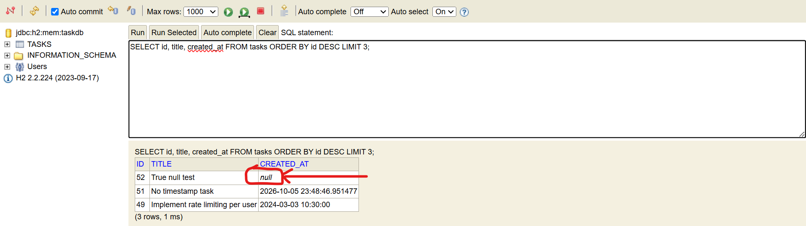 |
| 6 | 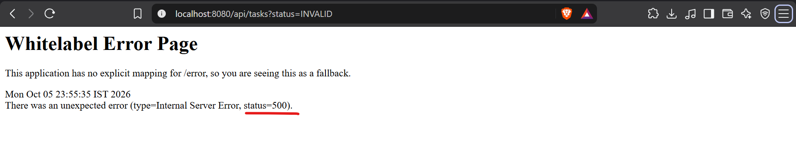 |

Handwritten notes: 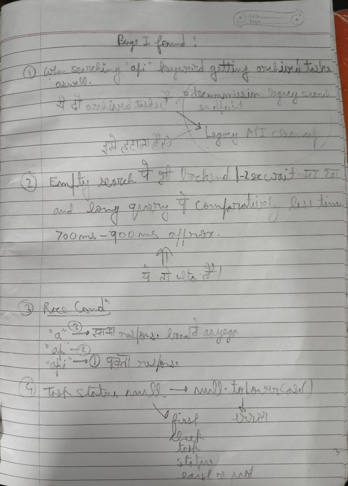 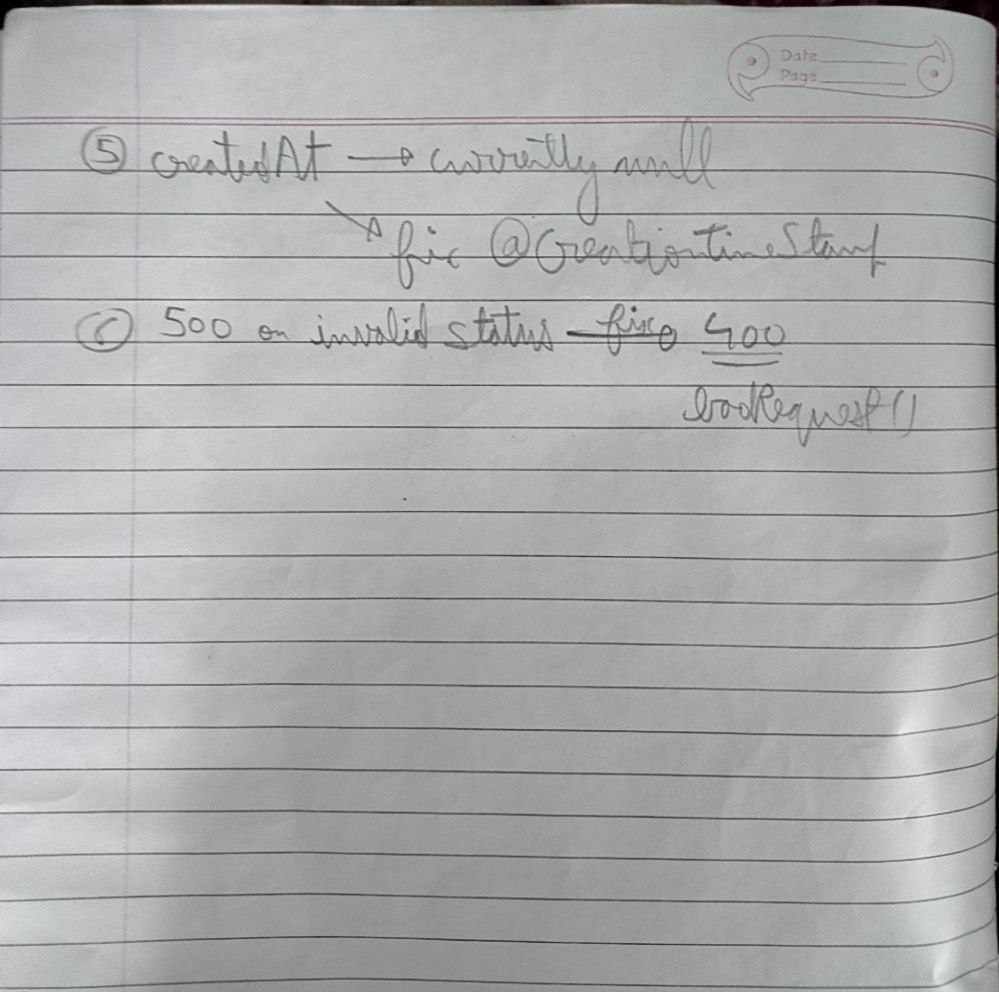

## What I chose not to change
- **Debounce**: aborting stale requests fixes correctness, but each keystroke still fires a request.
- **Page reset**: page isn't reset to 1 when the query changes.
- **In-memory pagination**: a bigger refactor than a patch.
- **Oracle package and `db/queries/`**: still contain the same precedence bug; they don't run locally.
- **Bug 4 is defensive**: the schema is `NOT NULL` on status, so the DB rejected my null insert (screenshot).

## Biggest remaining risk
`searchTasks` loads every matching row, then paginates in memory. `page` and `pageSize` are unvalidated, so `page=0` or a huge `pageSize` misbehaves. Combined with zero tests, regressions would go unnoticed.

## Tools and AI used
I reproduced each bug myself with the browser, DevTools Network tab and H2 console. I used Claude to help confirm root causes, draft fixes (parentheses, `AbortController`, `@CreationTimestamp`) and tidy these notes. I read each change and wrote the handwritten explanations myself.
